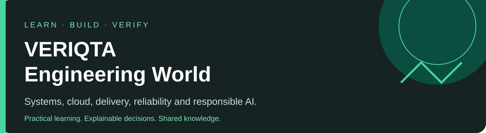
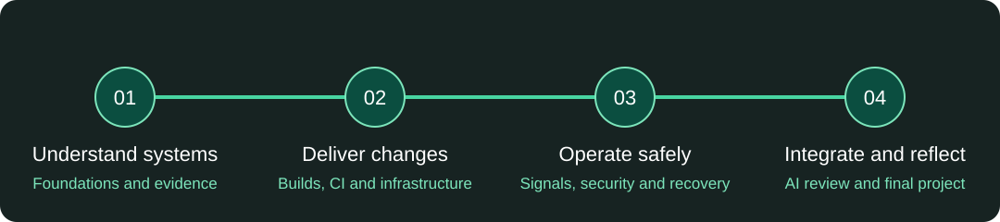

# VERIQTA Engineering World

**Learn how systems work. Build with purpose. Verify with evidence.**

An engineering learning library for curious beginners, practising engineers and experienced problem-solvers around the world. Explore explanations, hands-on activities, simulated incidents and projects that help you explain your decisions. **DevOps is our first learning area**, within a broader engineering library that will grow through substantive contributions.

[Start Learning](journey/days/day-01.md) · [Explore Topics](#explore-engineering-topics) · [Practical Labs](library/README.md#exercise) · [Challenges](challenges/README.md) · [Projects](library/README.md#project) · [AI for Engineering](ai/README.md) · [Contribute](CONTRIBUTING.md)

## Choose your starting point

Explore [AI for Engineering and DevOps](ai/README.md), including [engineering outcomes and evidence](ai/engineering-evidence/README.md). The [section sequence](docs/section-plan.md) shows prerequisites and planned expansion across engineering and AI.

| Your starting point | A useful first step | What you will practise |
| --- | --- | --- |
| New to engineering | [Start Day 1](journey/days/day-01.md), then follow the [curriculum](journey/README.md) | Safe local work, basic tools and observable outcomes |
| Working with systems | [Browse exercises and incidents](library/README.md) | Investigation, configuration review and delivery decisions |
| Seeking a deeper challenge | [Missing-telemetry incident](library/vw-i004.md) or [read-only assistant project](library/vw-p002.md) | Incomplete evidence, competing risks and evaluation design |

Use a text editor to begin. Practical pages state their prerequisites, supported environments, verification and cleanup. The first batch uses local work and offline fixtures; paid cloud accounts and model APIs are unnecessary. Windows learners can use WSL where a POSIX shell is required.

## Explore engineering topics

Choose a topic to see authored material and its planned expansion. The catalogue also supports browsing by [level](library/README.md#by-level) and [content type](library/README.md#by-type).

| Foundations | Build and deliver | Operate and improve |
| --- | --- | --- |
|  [Linux and operating systems](library/README.md#linux) |  [Containers and Docker](library/README.md#containers) |  [Kubernetes and Helm](library/README.md#kubernetes) |
| 🌐 [Networking, DNS, HTTP and TLS](library/README.md#networking) |  [Builds and CI/CD](library/README.md#delivery) |  [Observability](library/README.md#observability) |
|  [Git and GitHub](library/README.md#git) |  [Infrastructure as code](library/README.md#infrastructure) | 🧭 [Site reliability engineering](library/README.md#reliability) |
|  [Python](library/README.md#python) and [Bash](library/README.md#bash) |  [Configuration management](library/README.md#configuration) | 🛡️ [Security and DevSecOps](library/README.md#security) |
| ☁️ [Cloud — AWS first](library/README.md#cloud) | 🔄 [GitOps and Argo CD](library/README.md#gitops) | 🧩 [Platform engineering](library/README.md#platform) |
| 🧱 [Engineering foundations](library/README.md#foundations) | 🤖 [AI for Engineering](ai/README.md) | 📚 [All topics and planned coverage](library/README.md#by-topic) |

## 100-Day DevOps Journey

Build foundations through a realistic sequence: Linux and networking → Git and scripting → AWS and delivery → infrastructure, Kubernetes and GitOps → observability, security and reliability → responsible AI and an integrated project, followed by operational verification and a final demonstration. Review days and troubleshooting checkpoints connect the tools to engineering outcomes.

**[Open the complete 100-day curriculum](journey/README.md)** · [Begin Day 1](journey/days/day-01.md) · [First-week checkpoint](journey/days/day-07.md)

Days 1–7 are available; Days 8–100 are planned. Allow roughly 60 minutes per day and longer project sessions. Repeat or slow down as needed. Completing 100 days does not automatically establish professional competence.

## AI for Engineering and DevOps

Use assistance to investigate, automate and review while retaining responsibility for verification and decisions. The [AI learning area](ai/README.md) distinguishes prompt assistance, deterministic automation, retrieval-assisted systems and controlled agents.

| Try it with | Investigate or review | Verify independently |
| --- | --- | --- |
| [Linux](library/vw-a001.md) | A convincing disk diagnosis | Scope, evidence and unsafe commands |
| [AWS IAM](library/vw-a002.md) | An overbroad access policy | Actions, resources and missing access context |
| [Docker](library/vw-a003.md) | Secrets in a build context | Image layers and exclusion rules |
| [Kubernetes](library/vw-a004.md) | A false restart explanation | Probe roles and actual events |

Build on these with the [read-only evidence assistant](library/vw-p002.md): retrieval, structured output, evaluation, injection resistance and deterministic fallback. Defaults use sanitised fixtures and mock responses. Mock success does not establish real model performance.

## Learning paths

Paths connect existing lessons and activities. Follow them in order, attempt each task before opening its solution, and retain your own evidence and decisions.

| Path | Recommended route | Availability |
| --- | --- | --- |
| DevOps | [Day 1](journey/days/day-01.md) → [100-day curriculum](journey/README.md); build a record of observations and decisions | Days 1–7 available; remaining lessons planned |
| Cloud | [AWS IAM review](library/vw-a002.md) → [infrastructure replacement incident](library/vw-i003.md); explain authority and data risk | Starter route available; full AWS path and Azure/GCP expansion planned |
| SRE | [Latency SLI](library/vw-c004.md) → [missing-alert incident](library/vw-i004.md) → [reliability objective decision](library/vw-d002.md) | Starter route available; full operations path planned |
| Platform Engineering | Developer feedback, safe self-service, documentation discovery and measurable usability; see the [section plan](docs/section-plan.md) | Planned |
| Security | [CI trust review](library/vw-e003.md) → [log exposure incident](library/vw-i002.md) → [IAM review](library/vw-a002.md) | Starter route available; full path planned |
| AI | [Engineering evidence](ai/engineering-evidence/README.md) → [AI boundaries and tool exercises](ai/README.md) → [read-only assistant project](library/vw-p002.md) | Starter route available; further sections planned |

For future independent practice alongside these routes, see [planned challenges](challenges/README.md). They are not counted as completed exercises.

Use the starting-point guidance above to choose your level. Practical activities state their supported environments; use disposable local resources and keep experiments away from shared or production systems.

## Independent challenges

The [Challenges area](challenges/README.md) is reserved for independent mission-based problem solving. Its initial Linux, networking, Docker, Kubernetes and Terraform challenges are planned; no challenge is available to run yet. Guided exercises and larger multi-milestone projects remain separate formats.

## Featured practice and projects

| Practice | Focus | Level |
| --- | --- | --- |
| [Find the large file safely](library/vw-e001.md) | Filesystem evidence and cleanup scope | Beginner |
| [The service with no destinations](library/vw-i001.md) | Kubernetes selectors and endpoint evidence | Beginner |
| [Replacement in a Terraform plan](library/vw-i003.md) | Stateful change risk and recovery | Intermediate |
| [The alert that goes quiet](library/vw-i004.md) | Missing telemetry and alert evaluation | Advanced |
| [Build a release evidence bundle](library/vw-p001.md) | Tests, artifact identity and promotion decisions | Intermediate |
| [Build a read-only assistant](library/vw-p002.md) | Retrieval, boundaries and evaluation | Advanced |

Attempt an activity before opening its linked solution. All incident scenarios in this first batch are fictional simulations. Projects ask you to document decisions, limitations and what you actually built.

## Library progress

**22 authored library items · 7 authored days · 93 planned days · 18 planned domain expansions · 5 planned challenges.**

Supported checks and environments are documented in the [validation record](docs/validation.md).

| Authored canonical type | Count |
| --- | ---: |
| Concept questions | 4 |
| Practical exercises | 5 |
| Troubleshooting incidents | 5 |
| AI-assisted exercises | 4 |
| Engineering decisions | 2 |
| Mini-projects | 2 |

The daily activities are counted separately from canonical library items. Planned topics are not counted as completed content. [Machine-readable catalogues](catalogue/README.md) drive this progress table; [validation results](docs/validation.md) distinguish static checks, local execution and untested runtimes.

## Repository layout

| Folder | Purpose |
| --- | --- |
| `journey/` | The structured 100-Day DevOps Journey |
| `library/` | Topic-based questions, guided practice, incidents, decisions and projects |
| `ai/` | AI for engineering: curriculum plan, tool-specific workflows and related examples |
| `challenges/` | Independent engineering missions; initial scope is planned |
| `catalogue/` | Machine-readable IDs, navigation records and validation evidence |
| `docs/` | Contribution standards, roadmap and maintainer guidance |
| `assets/` | VERIQTA graphics and attributed visual assets |
| `scripts/` | Repository-wide validation and navigation generation |
| `tests/` | Automated tests for repository maintenance tools |
| `.github/` | Contribution forms and CI workflows |

Subject-specific examples, solutions and tests belong inside their learning area. Learning paths are maintained in this README.

## Community and contribution

Bring a correction, a reproducible lab result or a distinct engineering problem. Read [Contributing](CONTRIBUTING.md), the [content standard](docs/style-guide.md) and the [Code of Conduct](CODE_OF_CONDUCT.md). [Report an incorrect answer or broken lab](https://github.com/veriqta/VERIQTA-Engineering-World/issues/new/choose), or suggest a topic with a clear learning outcome.

Follow the [section sequence](docs/section-plan.md) and [roadmap](docs/roadmap.md) for planned learning units. **[MIT licensed](LICENSE):** reuse the original code and educational documentation with the required notice. See [licensing and brand guidance](docs/licensing.md) for asset terms and trademark boundaries.

[Asset licences and provenance](docs/attribution.md).
